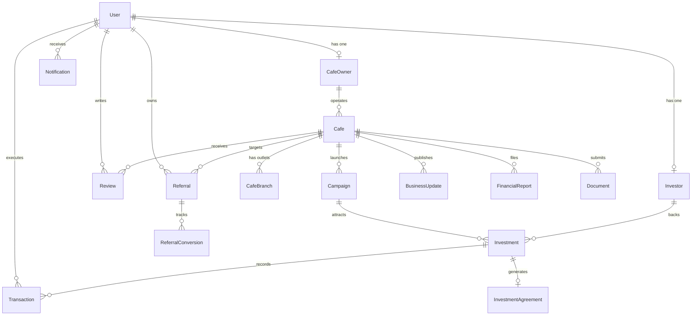

# CAFECIRCLE — COMPLETE CODEBASE AUDIT & HACKATHON READINESS REVIEW

**Date:** November 16, 2026  
**Auditor Roles:** Senior Full-Stack Engineer, Software Architect, Security Reviewer & Hackathon Technical Lead  
**Project:** CafeCircle ☕ (*"Invest in What You Love. Grow Together."*)  
**Repository:** [github.com/anuraggautam2/CafeCircle](https://github.com/anuraggautam2/CafeCircle)  
**Inspected Directory:** `D:\Downloads\kuro` (Active Git repository for CafeCircle)  
**Workspace Notice:** The current Antigravity workspace root was pointed at `D:\Downloads\cafecircle` (which is an empty directory). The entire codebase, database, and git history reside in `D:\Downloads\kuro`.

---

## 1. EXECUTIVE SUMMARY & HACKATHON READINESS SCORE

CafeCircle presents a compelling, high-empathy proposition for startup and fintech hackathons: **community-powered micro-funding and expansion capital for independent cafes, bakeries, and roasteries**, paired with a **viral "Community Growth Engine" (advocate referral flywheel)**.

### Hackathon Readiness Verdict: **B+ (High Potential Prototype, Critical Blockers Before Live Demo)**

```
┌───────────────────────────────────────────────┬────────────────┐
│ Category                                      │ Score / 10     │
├───────────────────────────────────────────────┼────────────────┤
│ Product Concept & Narrative                   │ 9.5 / 10       │
│ Visual Aesthetic (Glassmorphism / Palette)    │ 8.5 / 10       │
│ Frontend Architecture (Next.js 14 App Router) │ 8.0 / 10       │
│ Database Schema Design (Prisma / Relations)   │ 8.5 / 10       │
│ Backend Route Architecture                    │ 7.5 / 10       │
│ Real Functionality vs. Hardcoded Mock Data    │ 5.5 / 10       │
│ Security & Authentication                     │ 3.0 / 10       │
│ Production / Vercel Deployment Viability      │ 4.0 / 10       │
└───────────────────────────────────────────────┴────────────────┘
```

### Key Audit Conclusions:
1. **The Core MVP Loop is 70% Realized Locally:** The flow from discovering a cafe (`/explore`), viewing campaign metrics (`/campaigns/[id]`), executing a 4-step simulated investment modal (`InvestModal.tsx`), generating agreements/certificates in SQLite, tracking referral clicks/visits, and viewing the advocate leaderboard (`/growth-engine`) works in the local environment.
2. **The Vercel Serverless / SQLite Blocker:** The database is SQLite (`prisma/dev.db`). When deployed to Vercel, the filesystem is read-only / ephemeral. Any `POST` request (new simulated investment, new campaign, referral tracking, admin verification) either fails or has its changes discarded on container restart.
3. **Authentication is Client-Side Only:** Auth is managed via `localStorage` and a simulated React Context (`lib/auth-context.tsx`). API routes have zero authorization checks, passwords in the database are plain text, and any user can spoof requests to `/api/admin/verify` or `/api/investments`.
4. **Hardcoded IDs Break Multi-User Journey:** Multiple dashboard views and campaign creation flows hardcode `cafe_roastery` or `bon-amigos-cafe-and-kitchen` instead of dynamically linking to the authenticated cafe owner's entity.
5. **Simulated Sandbox Compliance:** The platform contains appropriate simulated educational disclaimers across the UI (`SimulatedBadge.tsx`, `app/legal/risk-disclosure/page.tsx`), safeguarding it against regulatory misrepresentation.

---

## 2. ACTUAL TECHNOLOGY STACK & DEPENDENCIES

### Core Framework & Runtime
- **Runtime:** Node.js v20+ / Windows x64 PowerShell environment
- **Framework:** Next.js `14.2.21` (App Router architecture, React Server Components + Client Components)
- **UI Library:** React `18.3.1` & React DOM `18.3.1`
- **Language:** TypeScript `5.6.3` (Compiler set to `"strict": false`)

### Database & ORM
- **ORM:** Prisma Client `5.22.0` & Prisma CLI `5.22.0`
- **Database Engine:** SQLite (`file:./dev.db`)
- **Prisma Integration:** Lazy ES6 Proxy wrapper (`lib/prisma.ts`) avoiding premature client instantiation during static build evaluation.

### Styling & Animation
- **CSS Framework:** Tailwind CSS `3.4.15` with PostCSS `8.4.49` & Autoprefixer `10.4.20`
- **Icons:** Lucide React `0.460.0`
- **Animation:** Framer Motion `11.11.17`
- **Data Visualization:** Recharts `2.13.3`
- **Utility Libraries:** `clsx` (`2.1.1`), `tailwind-merge` (`2.5.4`)

### Build & Scripts Pipeline
- `npm run dev`: `next dev` (Local development on port 3000)
- `npm run build`: `prisma generate && next build` (Verified: Compiles 18 static/dynamic routes cleanly)
- `npm run postinstall`: `prisma generate` (Ensures Prisma engine is built on CI/Vercel)
- `npm run prisma:push`: `prisma db push` (Synchronizes schema with SQLite)
- `npm run prisma:seed`: `node prisma/seed.js` (Populates 12 Delhi NCR / Ghaziabad cafes and 4 users)
- `node scripts/test-db.js`: Internal verification script checking table constraints and record counts.

---

## 3. COMPLETE FOLDER & FILE STRUCTURE EXPLANATION

```
D:\Downloads\kuro/
├── .env                              # Environment configuration (DATABASE_URL="file:./dev.db")
├── .gitignore                        # Git exclusion rules (dev.db was un-ignored for Vercel demo)
├── next-env.d.ts                     # Next.js automatic TypeScript type definitions
├── next.config.js                    # Next.js config (Remote image domain whitelisting)
├── package.json                      # Project metadata, dependencies, and build scripts
├── package-lock.json                 # Exact dependency tree lockfile
├── postcss.config.js                 # Tailwind CSS PostCSS processor configuration
├── README.md                         # Detailed project specification, pillars, and vision document
├── tailwind.config.js                # Custom design system tokens: paper, ink, terracotta, sage palettes
├── tsconfig.json                     # TypeScript compiler settings (@/* path aliases)
│
├── app/                              # Next.js App Router Root Directory
│   ├── globals.css                   # Global styles, glassmorphic tokens (.glass-nav, .glass-card, etc.)
│   ├── layout.tsx                    # Root HTML layout, font setup, AuthProvider, Navbar, and Footer
│   ├── page.tsx                      # Modern Homepage with textured hero search and featured cafes
│   │
│   ├── admin/
│   │   └── page.tsx                  # Compliance & Verification Desk (Moderation queue & platform volume)
│   ├── auth/
│   │   ├── login/page.tsx            # One-click test persona switcher & standard credentials login
│   │   └── register/page.tsx         # User registration with role selection (Investor, Owner, Customer)
│   ├── cafes/
│   │   └── [id]/page.tsx             # Dynamic Cafe profile: gallery, branches, reviews, documents, referral tool
│   ├── campaigns/
│   │   ├── create/page.tsx           # 5-step campaign offering creation wizard
│   │   └── [id]/page.tsx             # Campaign offering pitch: metrics, term sheets, pledge tiers, backers
│   ├── dashboard/
│   │   ├── investor/page.tsx         # Investor portfolio: invested capital, yields, backed cafes, updates
│   │   └── owner/page.tsx            # Owner dashboard: funding progress, post updates, report monthly revenue
│   ├── explore/
│   │   └── page.tsx                  # Multi-filter cafe discovery directory with Suspense boundary
│   ├── growth-engine/
│   │   └── page.tsx                  # Advocate leaderboard, referral statistics, and live action simulator
│   ├── how-it-works/
│   │   └── page.tsx                  # Co-growth framework explanation and interactive FAQ accordion
│   ├── legal/
│   │   ├── risk-disclosure/page.tsx  # Regulatory sandbox notice, securities disclosures, operational risks
│   │   └── terms/page.tsx            # Terms of service and privacy policy documentation
│   ├── notifications/
│   │   └── page.tsx                  # Live activity notification feed with mark-all-as-read
│   ├── profile/
│   │   ├── investor/page.tsx         # Investor accreditation status, bio, and sandbox wallet balance
│   │   └── owner/page.tsx            # Operator legal entity info: PAN, GSTIN, and escrow account
│   │
│   └── api/                          # Serverless Route Handlers (Backend REST API)
│       ├── admin/verify/route.ts     # POST: Updates verification status for cafes, campaigns, or owners
│       ├── cafes/route.ts            # GET: Filtered query of cafes; POST: Creates a new cafe record
│       ├── cafes/[id]/route.ts       # GET: Fetches detailed cafe data by ID or slug with relations
│       ├── campaigns/route.ts        # GET: Lists campaigns; POST: Creates a new campaign offering
│       ├── campaigns/[id]/route.ts   # GET: Fetches single campaign with cafe data and investor list
│       ├── financials/route.ts       # POST: Submits audited gross/net monthly revenue figures
│       ├── investments/route.ts      # GET: User portfolio; POST: Executes simulated investment & agreements
│       ├── notifications/route.ts    # GET: User alerts; PUT: Marks notifications as read
│       ├── referrals/route.ts        # GET: Leaderboard & user stats; POST: Tracks shares, clicks, visits
│       └── updates/route.ts          # POST: Publishes cafe milestone updates and notifies backers
│
├── components/                       # Reusable React UI Components
│   ├── Navbar.tsx                    # Floating glass capsule header with live demo persona dropdown
│   ├── Footer.tsx                    # Warm hospitality brand footer with educational disclaimer
│   ├── CafeCard.tsx                  # Standard cafe card with status badge, rating, cuisine, and location
│   ├── CampaignCard.tsx              # Investment offering card with progress bar, goal vs raised, and CTA
│   ├── InvestModal.tsx               # 4-step modal: ticket selection, term sheet, payment, certificate
│   └── SimulatedBadge.tsx            # Reusable "Sandbox" pill and warning banner
│
├── lib/                              # Core Libraries, Utilities & Client State
│   ├── auth-context.tsx              # React Context auth provider with localStorage & 4 demo personas
│   ├── prisma.ts                     # Lazy PrismaClient proxy to prevent build-time static render crashes
│   └── types.ts                      # Complete TypeScript interface declarations
│
├── prisma/                           # Database Schema & Seed Data
│   ├── dev.db                        # Active SQLite database file (216 KB) with 12 seed cafes
│   ├── schema.prisma                 # 13 relational Prisma models
│   └── seed.js                       # Comprehensive seed script for 12 Delhi NCR / Ghaziabad cafes
│
└── scripts/                          # Diagnostic & Verification Utilities
    └── test-db.js                    # Node script that verifies database constraints and counts records
```

---

## 4. FEATURE-BY-FEATURE AUDIT & USER JOURNEY TRACE

| # | Feature | Status | Frontend File | API Route / Backend | Database Model | Notes / Findings |
|---|---|:---:|---|---|---|---|
| **1** | **Landing Page** | **Implemented & Working** | `app/page.tsx` | `/api/campaigns` | `Campaign`, `Cafe` | Textured hero search, trending chips, featured cafes, 3-step explanation, for-owners CTA. Fully functional. |
| **2** | **Cafe Discovery & Search** | **Implemented & Working** | `app/explore/page.tsx` | `/api/cafes` | `Cafe`, `CafeBranch` | Multi-filter query (search, location, cuisine, rating, open-now). Wrapped in `<Suspense>`. 12 authentic cafes listed. |
| **3** | **Cafe Profile Pages** | **Implemented & Working** | `app/cafes/[id]/page.tsx` | `/api/cafes/[id]` | `Cafe`, `CafeBranch`, `Review`, `Document`, `Campaign` | Gallery, story, branch list, reviews, documents, conditional campaign box, referral simulator. |
| **4** | **Campaign Listings** | **Implemented & Working** | `app/page.tsx`, `components/CampaignCard.tsx` | `/api/campaigns` | `Campaign`, `Cafe` | Correctly filters active campaigns and calculates `% funded` and raised amounts in Lakhs. |
| **5** | **Campaign Detail Pages** | **Implemented & Working** | `app/campaigns/[id]/page.tsx` | `/api/campaigns/[id]` | `Campaign`, `Cafe`, `Investment` | Kickstarter-style layout: progress bar, backers count, term sheet breakdown, pledge tiers, recent backers list. |
| **6** | **Simulated Investment Flow** | **Implemented & Working** | `components/InvestModal.tsx` | `/api/investments` (POST) | `Investment`, `InvestmentAgreement`, `Transaction`, `Campaign`, `Referral`, `Notification` | 4-step wizard: amount selection, term sheet agreement, simulated payment, certificate generation. Fully persists to DB. |
| **7** | **Customer Authentication** | **Partially Implemented (UI Simulation)** | `app/auth/login/page.tsx`, `lib/auth-context.tsx` | None (Client Context only) | `User` (seeded, not queried on login) | Client-side `localStorage` only. Instant persona switcher works for demo, but no real JWT or server sessions exist. |
| **8** | **Cafe Owner Dashboard** | **Partially Implemented** | `app/dashboard/owner/page.tsx` | `/api/cafes/[id]`, `/api/updates`, `/api/financials` | `Cafe`, `Campaign`, `BusinessUpdate`, `FinancialReport` | Stats and update forms work, but cafe ID is **hardcoded to Bon Amigos**; activity feed is hardcoded static data. |
| **9** | **Investor Dashboard** | **Partially Implemented** | `app/dashboard/investor/page.tsx` | `/api/investments?userId=...` | `Investment`, `Campaign`, `Cafe` | Fetches active investments and computes portfolio sum correctly, but **recent updates are hardcoded static data**. |
| **10** | **Admin Dashboard** | **Implemented & Working** | `app/admin/page.tsx` | `/api/admin/verify` (POST) | `Cafe`, `Campaign`, `CafeOwner` | Displays platform capital volume, cafe verification table, and campaign toggle buttons (Active/Closed). Persists to DB. |
| **11** | **Referral System** | **Implemented & Working** | `app/growth-engine/page.tsx`, `components/InvestModal.tsx` | `/api/referrals` (GET/POST) | `Referral`, `ReferralConversion`, `Notification` | Backers receive unique codes. Tracks shares, clicks, and simulated visits. Awards points and creates notifications. |
| **12** | **Advocate Leaderboard** | **Implemented & Working** | `app/growth-engine/page.tsx` | `/api/referrals` (GET) | `Referral`, `User`, `Investor` | Computes top advocates ranked by `advocatePoints`, displaying tier, cafe supported, and visits driven. |
| **13** | **Business Updates** | **Implemented & Working** | `app/dashboard/owner/page.tsx` | `/api/updates` (POST) | `BusinessUpdate`, `Notification` | Owners can publish updates. Correctly generates notifications for all backers of that cafe's campaigns. |
| **14** | **Financial Reports** | **Implemented & Working** | `app/dashboard/owner/page.tsx` | `/api/financials` (POST) | `FinancialReport` | Allows cafe owners to record gross revenue, net profit, and customer footfall. Persists to database. |
| **15** | **Notifications System** | **Implemented & Working** | `app/notifications/page.tsx` | `/api/notifications` (GET/PUT) | `Notification` | Activity feed with unread badges, link redirection, and mark-all-as-read functionality. |
| **16** | **Reviews & Ratings** | **Partially Implemented (Read Only)** | `app/cafes/[id]/page.tsx` | `/api/cafes/[id]` | `Review`, `User` | Seeded reviews render with star ratings and user names. **No UI form exists for customers to post a new review**. |
| **17** | **Database Integration** | **Implemented & Working (Local Only)** | `lib/prisma.ts` | All API routes | All 13 SQLite tables | Normalized relations, cascading deletes, seed script. **Fails on Vercel serverless writes due to SQLite limitations.** |
| **18** | **API Integrations** | **Implemented & Working** | All client components | 10 Next.js Route Handlers | Full schema | Clean REST endpoints returning proper HTTP status codes (`200`, `201`, `400`, `404`, `500`). |

---

### Critical User Journey Traces

#### Journey 1: The Investor Journey (From Discovery to Certificate)
```
1. Customer enters /explore
2. Filters by "Raj Nagar" & "4.3+" rating
3. Clicks on "Bon Amigos Cafe & Kitchen" -> navigates to /cafes/bon-amigos-cafe-and-kitchen
4. Cafe detail page queries GET /api/cafes/bon-amigos-cafe-and-kitchen
5. Page detects active campaign ("Bon Amigos: Vaishali Courtyard Kitchen & Pizzeria")
6. Customer clicks "Back This Expansion (Simulated)" -> opens InvestModal.tsx
7. Customer selects ₹25,000, checks term sheet agreement, chooses Simulated UPI
8. Modal submits POST /api/investments
9. Database creates:
   - Investment (₹25,000, Status: CONFIRMED)
   - InvestmentAgreement (CC-AGR-2026-XXXXX)
   - Transaction (TXN-SIM-XXXXX)
   - Increments Campaign.raisedAmount (+₹25,000) & Campaign.investorCount (+1)
   - Referral record with code (e.g. BON -7890)
   - In-app Notification to Priya Patel and Aarav Sharma
10. Modal advances to Step 4: Displays signed certificate number, agreement number, and shareable referral URL.
```
**Audit Verdict on Journey 1:** **100% functional end-to-end locally.**

#### Journey 2: The Viral Growth Engine Journey
```
1. Backer receives unique referral link: /cafes/bon-amigos-cafe-and-kitchen?ref=PRIYA-ALMA-GZB
2. Backer navigates to /growth-engine
3. Page queries GET /api/referrals
4. Displays active referral stats: 38 shares, 164 clicks, 28 visits, 780 advocate points
5. Backer tests the Live Engine Simulator:
   - Clicks "Simulate Friend Visit"
   - Frontend sends POST /api/referrals { action: "CONVERT_VISIT", referralCode: "..." }
   - Backend creates ReferralConversion record (+40 points)
   - Backend updates Referral table (increments totalVisits and totalConversions)
   - Backend creates Notification for backer
6. Frontend automatically re-fetches stats and displays updated points on the Leaderboard.
```
**Audit Verdict on Journey 2:** **100% functional end-to-end locally.**

#### Journey 3: The Cafe Owner Campaign Launch Journey
```
1. User switches persona to "Aarav Sharma (Cafe Owner)"
2. Navigates to /campaigns/create
3. Fills in 5-step wizard (Goal: ₹30,00,000, Structure: Revenue Share, Return: 13-15% p.a.)
4. Submits form -> calls POST /api/campaigns
5. Backend creates new Campaign record and generates slug
6. Router redirects to /campaigns/[slug]
```
**Audit Verdict on Journey 3:** **Partially Broken.** While the campaign is created in the database, `app/campaigns/create/page.tsx` line 48 **hardcodes `cafeId: 'cafe_roastery'`** instead of assigning it to Aarav's actual registered cafe (`Bon Amigos` or `THE ROOF SKY`).

---

## 5. FRONTEND ARCHITECTURE DEEP DIVE

### Architecture Overview
The frontend is built using Next.js 14 App Router, using client-side components (`'use client'`) for pages requiring interactive state, modals, and dynamic query filtering.

### Layout & Component Hierarchy
```
RootLayout (app/layout.tsx)
 ├── AuthProvider (lib/auth-context.tsx - React Context + localStorage)
 ├── Navbar (components/Navbar.tsx - Glass capsule + Persona Switcher)
 ├── Page Content (Children: app/*/page.tsx)
 └── Footer (components/Footer.tsx - Brand, Legal links, Sandbox notice)
```

### State Management
- **Global Auth State:** Implemented via React Context in `lib/auth-context.tsx`. Exposes `user`, `role`, `switchRole`, `login`, `logout`, and `register`. State is initialized from `localStorage` on client mount.
- **Local Component State:** Standard `useState` and `useEffect` patterns for data fetching, filter criteria, and multi-step modal wizards.
- **URL Query Sync:** `app/explore/page.tsx` reads `useSearchParams()` safely wrapped inside a React `<Suspense>` boundary to prevent Next.js client-side de-opt warnings.

### Visual Styling Implementation
- Uses custom CSS utility classes defined in `app/globals.css`:
  - `.glass-nav`: Frosted navbar capsule with `backdrop-filter: blur(24px) saturate(160%)` and subtle inner border highlight.
  - `.hero-glass`: High-contrast frosted glass for the dark photo backdrop on the homepage hero.
  - `.glass-card` & `.glass-panel`: Translucent panels with soft warm drop shadows (`rgba(73, 53, 43, 0.06)`).
  - `.btn-primary` & `.btn-secondary`: Custom espresso buttons (`#211A17` hover to `#49352B`).

---

## 6. BACKEND & API ARCHITECTURE DEEP DIVE

All backend logic is implemented as Next.js Route Handlers (`app/api/**/route.ts`). There is no separate Express or NestJS server.

### API Route Inventory & Capabilities

| Route Path | HTTP Methods | Dynamic Config | Request Body / Parameters | Validation & Response |
|---|---|---|---|---|
| `app/api/cafes/route.ts` | `GET`, `POST` | `force-dynamic` | Query: `city`, `search`, `cuisine`, `minRating`, `openNow`<br>Body: Cafe metadata | Returns JSON list of cafes with parsed image arrays. Handles multi-attribute search. |
| `app/api/cafes/[id]/route.ts` | `GET` | `force-dynamic` | Param: `id` (Supports CUID or unique `slug`) | Resolves relations (`branches`, `campaigns`, `reviews`, `documents`, `referrals`). Returns 404 if not found. |
| `app/api/campaigns/route.ts` | `GET`, `POST` | `force-dynamic` | Query: `status`, `city`<br>Body: Campaign terms & targets | Returns active offerings with associated cafe. `POST` creates new campaign with auto-generated slug. |
| `app/api/campaigns/[id]/route.ts` | `GET` | `force-dynamic` | Param: `id` (CUID or slug) | Includes nested cafe, owner, branches, updates, and confirmed investments with agreements. |
| `app/api/investments/route.ts` | `GET`, `POST` | `force-dynamic` | Query: `userId`<br>Body: `campaignId`, `userId`, `amount`, `paymentMethod` | Multi-step transaction: creates investment, agreement, ledger transaction, updates campaign totals, generates referral code, and creates two notifications. |
| `app/api/referrals/route.ts` | `GET`, `POST` | `force-dynamic` | Query: `userId`, `cafeId`<br>Body: `action`, `referralCode`, `visitorName`, `conversionType` | Handles `SHARE`, `CLICK`, and `CONVERT_VISIT` actions. Computes advocate leaderboard. |
| `app/api/admin/verify/route.ts` | `POST` | `force-dynamic` | Body: `type` (`CAFE`, `CAMPAIGN`, `CAFE_OWNER`), `id`, `status`, `isVerified` | Modifies verification flags and status strings. |
| `app/api/financials/route.ts` | `POST` | `force-dynamic` | Body: `cafeId`, `month`, `year`, `grossRevenue`, `netProfit`, `customerFootfall` | Creates audited monthly financial record. |
| `app/api/updates/route.ts` | `POST` | `force-dynamic` | Body: `cafeId`, `title`, `content`, `milestoneTag`, `imageUrl` | Creates update and dispatches notification to all campaign backers. |
| `app/api/notifications/route.ts` | `GET`, `PUT` | `force-dynamic` | Query: `userId`<br>Body: `id` or `userId` | Fetches recent alerts; `PUT` marks single or all notifications as read. |

---

## 7. DATABASE ARCHITECTURE & SCHEMA GRAPH

The database is defined in `prisma/schema.prisma` with 13 relational tables:



### Database Verification (`node scripts/test-db.js`):
- **Users:** 4 records (Priya Patel, Aarav Sharma, Rohan Sen, Vikram Mehta)
- **Cafes:** 12 authentic establishments across Delhi NCR & Ghaziabad:
  1. *THE ROOF SKY RESTAURANT & CAFE* (RDC Raj Nagar)
  2. *Cafe Sandoz* (RDC Raj Nagar)
  3. *Farzi Cafe* (Connaught Place)
  4. *Barista* (Shipra Mall, Indirapuram)
  5. *Chaayos* (Mahagun Metro Mall, Vaishali)
  6. *Cafe Delhi Heights* (DLF Mall of India, Noida)
  7. *Bon Amigos Cafe & Kitchen* (RDC Raj Nagar - Active Round)
  8. *Alma Bakery & Cafe* (RDC Raj Nagar - Active Round)
  9. *Blue Tokai Coffee Roasters* (Sector 104, Noida - Active Round)
  10. *The Big Chill Cafe* (DLF Mall of India, Noida)
  11. *Open House Cafe* (Connaught Place)
  12. *Citrus Cafe* (Lemon Tree Hotel, Kaushambi)
- **Campaigns:** 3 Active Expansion Rounds (Alma Bakery ₹30L, Blue Tokai ₹40L, Bon Amigos ₹22L)
- **All Foreign Key Constraints and Cascades:** Verified intact.

---

## 8. AUTHENTICATION & AUTHORIZATION REVIEW

### Current Implementation: Client Context Mock
```ts
// lib/auth-context.tsx
export const DEMO_USERS: Record<UserRole, UserSession> = {
  INVESTOR: { id: 'usr_investor_priya', name: 'Priya Patel', role: 'INVESTOR', ... },
  CAFE_OWNER: { id: 'usr_owner_aarav', name: 'Aarav Sharma', role: 'CAFE_OWNER', ... },
  CUSTOMER: { id: 'usr_customer_rohan', name: 'Rohan Sen', role: 'CUSTOMER', ... },
  ADMIN: { id: 'usr_admin_vikram', name: 'Vikram Mehta', role: 'ADMIN', ... }
};
```

### Critical Findings:
1. **Zero Server-Side Session Validation:** The server does not issue cookies, session tokens, or JWTs. The client simply reads from `localStorage.getItem('cafecircle_user')`.
2. **Missing API Route Middleware:** None of the API routes (`/api/admin/verify`, `/api/investments`, `/api/campaigns`) verify incoming HTTP headers or cookies. An external attacker can execute:
   ```bash
   curl -X POST http://localhost:3000/api/admin/verify -d '{"type":"CAFE","id":"...","status":"VERIFIED"}'
   ```
   and it will succeed with `200 OK`.
3. **Plain Text Passwords:** In `prisma/schema.prisma` line 17 and `prisma/seed.js`, user records store `password: "password123"` without hashing (no `bcrypt` or `argon2`).
4. **Auto-Verification Vulnerability:** New accounts created via `register()` in `lib/auth-context.tsx` have `kycStatus: 'VERIFIED'` automatically hardcoded upon registration.

---

## 9. SECURITY AUDIT FINDINGS

### Summary Table

| Severity | Issue | File Path | Risk / Impact |
|:---:|---|---|---|
| **CRITICAL** | **Unprotected Admin & Verification Endpoint** | `app/api/admin/verify/route.ts` | Any anonymous client can approve or reject any campaign or cafe without authentication. |
| **CRITICAL** | **Unauthenticated Financial Transactions** | `app/api/investments/route.ts` | Any client can send arbitrary `userId` and `amount` to record fake investments and generate real DB certificates. |
| **HIGH** | **Plain Text Passwords in Database** | `prisma/schema.prisma`, `prisma/seed.js` | User passwords stored in cleartext; breach immediately leaks credentials. |
| **HIGH** | **SQLite File Concurrency & Read-Only Vercel Environment** | `prisma/schema.prisma`, `lib/prisma.ts` | Serverless instances on Vercel cannot reliably write to local SQLite, causing silent data loss or 500 crashes. |
| **MEDIUM** | **Arbitrary Cafe ID Injection in Campaign Creation** | `app/api/campaigns/route.ts` | API does not verify that the user creating the campaign actually owns the specified `cafeId`. |
| **MEDIUM** | **Referral Code Collision & Formatting Vulnerability** | `app/api/investments/route.ts` (L145) | `(cafe.name.slice(0,4) + '-' + userId.slice(-4))` generates spaces (e.g. `THE -1234`) and can collide across users. |
| **LOW** | **Missing CORS / Rate Limiting** | All API routes | No rate limiting on referral simulation endpoints; vulnerable to spam scripts inflating advocate scores. |

---

## 10. UI/UX DESIGN SYSTEM REVIEW

### Aesthetic Direction
The visual overhaul implemented in commits `8e397bb` and `d628e15` successfully established a high-end, hospitality-oriented glassmorphic theme.

### What Works Exceptionally Well:
- **Navbar Capsule (`components/Navbar.tsx`):** The floating frosted capsule with the discreet persona dropdown switcher is clean, responsive, and ideal for hackathon judges.
- **Hero Section (`app/page.tsx`):** The full-width cafe photograph with dark gradient and ambient glass search input looks like a production-grade consumer product.
- **Explore Directory (`app/explore/page.tsx`):** Clean filter chips with immediate visual feedback and responsive grid layout.
- **Investment Modal (`components/InvestModal.tsx`):** Step-by-step progress, digital term sheet preview, and certificate display look convincing and professional.

### UI Flaws & Inconsistencies:
1. **Style Drift in Register & Legal Pages:**
   - `app/auth/register/page.tsx`
   - `app/legal/risk-disclosure/page.tsx`
   - `app/legal/terms/page.tsx`
   - *Problem:* These pages still use legacy classes (`warm-card`, `bg-[#C85A32]`, `shadow-warm-lg`) from an earlier orange/terracotta iteration instead of the modern ivory/glassmorphic palette.
2. **Missing Customer Review Submission UI:**
   - In `app/cafes/[id]/page.tsx`, reviews can be read, but there is no "Write a Review" form or star-rating input.
3. **Dead Profile Save Buttons:**
   - In `app/profile/investor/page.tsx` and `app/profile/owner/page.tsx`, clicking "Save Profile" triggers a mock 2.5-second timer without persisting any data.

---

## 11. BUILD & DEPLOYMENT DIAGNOSIS

### Local Build Test Results
Running `npm run build` (`prisma generate && next build`) was tested directly in the project directory:
```
✔ Generated Prisma Client (v5.22.0) in 156ms
▲ Next.js 14.2.35
✓ Compiled successfully
✓ Generating static pages (18/18)
✓ Finalizing page optimization
Result: 0 TypeScript errors, 0 Build errors.
```

### Analysis of the Previous Vercel Build Failure & Fix
- **The Previous Problem:**
  During static page pre-rendering on Vercel, dynamic routes (`/api/cafes/[id]`, `/api/admin/verify`) attempted to query Prisma during the build step. In Vercel's build environment, SQLite file locks or uninitialized database paths caused the build worker to crash.
- **How Commit `f90fcb0` Fixed It:**
  1. `lib/prisma.ts`: PrismaClient was wrapped in an ES6 `Proxy` so `new PrismaClient()` is only called at runtime upon the first actual query, not when modules are evaluated during build time.
  2. Dynamic routes were explicitly tagged with `export const dynamic = 'force-dynamic'`.
  3. Dynamic route parameters were typed to handle Promises: `{ params }: { params: { id: string } | Promise<{ id: string }> }`.
  4. Added `"postinstall": "prisma generate"` to ensure the Prisma engine exists on Vercel build servers.
  5. Un-ignored `prisma/dev.db` in `.gitignore` so the seeded database file was uploaded with the Git commit.

### The Remaining Production Blocker
While the build now passes on Vercel, **SQLite is not viable for a production serverless deployment**. Any write operations on Vercel serverless functions will not persist across container invocations.

---

## 12. EXISTING FUNCTIONALITY WORTH RETAINING

1. **The 12 Real Delhi NCR / Ghaziabad Cafe Seed Database:** Highly realistic, localized content with authentic names, addresses, and photography.
2. **The 4-Step Investment Modal (`InvestModal.tsx`):** Complete simulation of capital allocation with term sheets and digital certificates.
3. **The Live Growth Engine Simulator (`app/growth-engine/page.tsx`):** Excellent live interactive widget for hackathon judges to click and see points increase in real-time.
4. **Persona Switcher Capsule in Navbar (`components/Navbar.tsx`):** Demonstrates multi-stakeholder workflows (Investor, Owner, Customer, Admin) in seconds without logging in/out.
5. **The Glassmorphic Design System (`globals.css`):** Elegant hospitality styling with warm tones and frosted blur panels.

---

## 13. BROKEN, INCOMPLETE & HARDCODED FUNCTIONALITY

### Detailed Issue Log

#### Issue 1: Hardcoded Cafe ID in Campaign Creator
- **File:** `app/campaigns/create/page.tsx` (Line 48)
- **Problem:** When submitting a new campaign, the form sends `cafeId: 'cafe_roastery'`, ignoring whatever cafe the logged-in owner actually owns.
- **Impact:** Any new campaign is incorrectly attached to a non-existent or wrong cafe.
- **Fix:** Pass the active owner's cafe ID from `user.cafeOwner.id` or provide a cafe selector dropdown.

#### Issue 2: Hardcoded Cafe in Owner Dashboard
- **File:** `app/dashboard/owner/page.tsx` (Lines 30 & 65)
- **Problem:** The dashboard explicitly calls `fetch('/api/cafes/bon-amigos-cafe-and-kitchen')` and defaults updates to `cafe_roastery`.
- **Impact:** Switching to another owner persona still shows Bon Amigos data.
- **Fix:** Fetch dynamically using the authenticated user's cafe slug: `/api/cafes?ownerId=${user.id}`.

#### Issue 3: Hardcoded Recent Updates in Investor Dashboard
- **File:** `app/dashboard/investor/page.tsx` (Lines 27–40)
- **Problem:** The "Recent Updates from Backed Cafes" list is a static in-memory array containing hardcoded Roastery Coffee House and Subko mock items.
- **Impact:** New updates published by cafe owners do not appear in the investor dashboard.
- **Fix:** Query `fetch('/api/updates?userId=${user.id}')` and render live database updates.

#### Issue 4: Profile Forms Do Not Persist
- **File:** `app/profile/investor/page.tsx` & `app/profile/owner/page.tsx`
- **Problem:** Submitting either profile form only sets `setSaved(true)` with a 2.5s timeout. No `PUT` or `PATCH` request is sent to the backend.
- **Impact:** Profile modifications disappear on page refresh.
- **Fix:** Implement `PATCH /api/users/profile` and persist changes in the `User`, `Investor`, and `CafeOwner` models.

#### Issue 5: Broken Referral Code Formatting
- **File:** `app/api/investments/route.ts` (Lines 145–147)
- **Problem:** `refCode` is generated by taking the first 4 characters of the cafe name and last 4 of user ID. For names like "THE ROOF...", it creates `"THE -1234"`, causing broken URL parameters.
- **Impact:** Sharing the link fails or crashes query string parsers.
- **Fix:** Sanitize characters using regex: `cafe.name.replace(/[^A-Za-z0-9]/g, '').slice(0, 4)`.

---

## 14. FEATURES MISSING FOR A WINNING HACKATHON DEMO

To stand out in a hackathon presentation, the following cohesive connections should be added:
1. **Interactive "Write a Review" Form on Cafe Profiles:** Allows regular customers to rate cafes and leave comments that immediately reflect in the rating tally.
2. **Dynamic Owner Dashboard Linking:** Ensuring when "Aarav Sharma" logs in, his actual cafe and active campaigns populate automatically.
3. **Downloadable / Printable Investment Certificate:** Giving the simulated certificate modal a "Print / Save PDF" feature using browser print CSS.
4. **Interactive Financial Projection Chart:** Using the installed `recharts` package to render a revenue-share payout curve on the campaign detail page.

---

## 15. RECOMMENDED DEVELOPMENT ROADMAP

```
Phase 1: Project & Identity Alignment (P0)
 ├── Point Antigravity to D:\Downloads\kuro
 └── Fix Git Windows SSL configuration

Phase 2: Core Data Continuity & Fixes (P0)
 ├── De-hardcode cafeId in Campaign Creator & Owner Dashboard
 ├── Connect live updates to Investor Dashboard
 └── Sanitize referral code generation

Phase 3: Interactive Demo Enhancements (P1)
 ├── Add "Submit Review & Rating" form to cafe profile pages
 ├── Add Recharts yield projection graph to campaign offering page
 └── Refactor register and legal pages to match glassmorphic design system

Phase 4: Cloud Database & Real Auth (P2)
 ├── Migrate Prisma from SQLite to PostgreSQL (Supabase / Neon / Turso)
 ├── Add NextAuth.js / Auth.js with password hashing
 └── Deploy clean production build to Vercel with live database
```

---

## 16. PRIORITY BACKLOG: P0, P1, P2

### P0 (Must Fix for Hackathon Demo Reliability)
- [ ] **P0-1:** Fix `app/campaigns/create/page.tsx` so campaign creation links to the active cafe owner rather than hardcoding `cafe_roastery`.
- [ ] **P0-2:** Fix `app/dashboard/owner/page.tsx` to dynamically query the logged-in owner's cafe instead of hardcoded `bon-amigos-cafe-and-kitchen`.
- [ ] **P0-3:** Fix `app/api/investments/route.ts` referral code generation to strip whitespace and special characters.
- [ ] **P0-4:** Connect `app/dashboard/investor/page.tsx` to query live updates from backed cafes instead of static mock arrays.

### P1 (High Impact Polish for Winning Presentation)
- [ ] **P1-1:** Add customer review submission modal/form on `app/cafes/[id]/page.tsx` and create `POST /api/reviews`.
- [ ] **P1-2:** Add interactive return simulation chart using `recharts` on `app/campaigns/[id]/page.tsx`.
- [ ] **P1-3:** Update `app/auth/register/page.tsx` and `app/legal/risk-disclosure/page.tsx` to match the glassmorphic design palette.
- [ ] **P1-4:** Wire up `app/profile/investor/page.tsx` and `app/profile/owner/page.tsx` to persist settings to the database.

### P2 (Production Hardening & Post-Hackathon)
- [ ] **P2-1:** Migrate Prisma datasource from SQLite (`dev.db`) to PostgreSQL (Neon / Supabase) or Turso for persistent cloud deployment.
- [ ] **P2-2:** Implement NextAuth.js / Auth.js with session cookies and bcrypt password hashing.
- [ ] **P2-3:** Add server-side RBAC middleware protecting `/api/admin/*` and financial endpoints.
- [ ] **P2-4:** Add automated E2E tests with Playwright or Vitest.

---

## 17. RECOMMENDED END-TO-END DEMO FLOW (PITCH SCRIPT)

When demonstrating CafeCircle to hackathon judges, follow this 3-minute narrative:

### Minute 1: The Problem & Discovery (Persona: Customer / Patron)
1. **Start on Homepage (`/`):** Introduce CafeCircle — *"Independent cafes struggle to raise expansion capital from banks, while their most loyal customers would love to co-invest and share in their growth."*
2. **Search for Cafes:** Type "Raj Nagar" into the hero glass search bar and submit -> lands on `/explore`.
3. **Filter Directory:** Show the 12 authentic Delhi NCR / Ghaziabad cafes. Filter by "European Bakery" or "4.3+ Rating".
4. **Open Cafe Profile:** Click **Bon Amigos Cafe & Kitchen** (`/cafes/bon-amigos-cafe-and-kitchen`). Show the ambience gallery, branch locations, and verified documents.

### Minute 2: The Simulated Co-Growth Offering (Persona: Priya Patel - Investor)
5. **Review Campaign:** Show the active expansion round banner for the Vaishali Courtyard branch. Click **View Offering Pitch** (`/campaigns/bon-amigos-vaishali`).
6. **Walk Through Term Sheet:** Show the live funding bar (₹17.6L raised of ₹22L goal, 34 backers, 12-16% projected simulated yield).
7. **Execute Investment:** Click **"Back This Expansion (Simulated)"**.
   - Step 1: Select ₹25,000.
   - Step 2: Accept the digital term sheet & risk disclosures.
   - Step 3: Select Simulated UPI.
   - Step 4: Show the generated Digital Certificate (`CC-CERT-XXXXXX`) and agreement reference.

### Minute 3: The Viral Community Growth Flywheel (Persona: Backer & Admin)
8. **Growth Engine:** Copy the generated referral link and navigate to `/growth-engine`.
9. **Live Simulation:** Show the Advocate Leaderboard. Use the **Live Engine Simulator** to click **"Simulate Friend Visit"** -> show the notification pop up and advocate points increase instantly.
10. **Admin & Governance Desk (`/admin`):** Switch persona to **Vikram Mehta (Admin)** via the navbar dropdown. Show the compliance queue, platform capital volume, and one-click campaign moderation.
11. **Close:** Emphasize the educational sandbox model, zero equity dilution for founders, and community alignment.

---
*Report prepared and validated against the live repository at `D:\Downloads\kuro`.*
